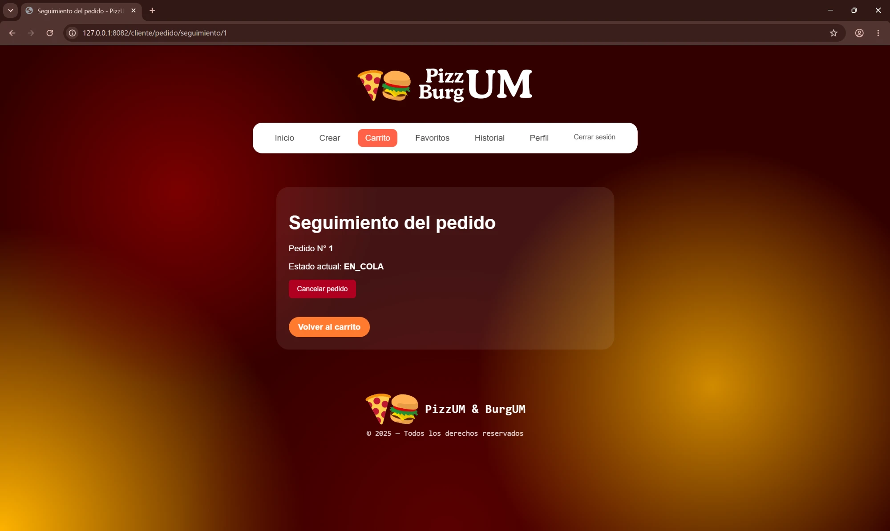
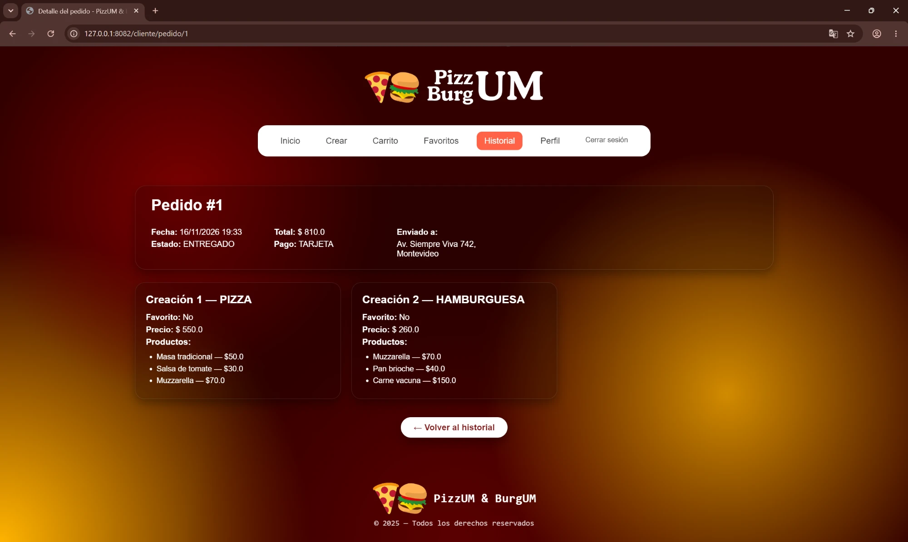
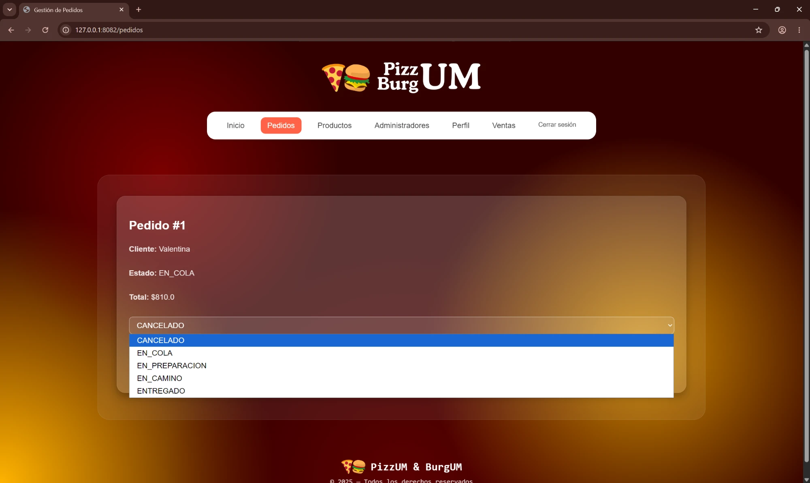

# Entregable 4: CI/CD

# Pipeline y despliegue simulado

## Arquitectura y decisiones

Reutilizamos PizzUM-BurgUM como base para el Entregable 4. Configuramos Jenkins para que tome el código de GitHub, ejecute las pruebas, genere el JAR y despliegue esa versión en un ambiente simulado. El flujo queda definido en el [Jenkinsfile](../Jenkinsfile).

Jenkins corre en Docker con Java 21. El ambiente simulado tiene su propio contenedor de aplicación y una base PostgreSQL separada del ambiente de desarrollo. Jenkins está disponible en el puerto `8081` y la aplicación simulada en el `8082`. Usamos un volumen compartido para pasar el JAR desde Jenkins al contenedor de la aplicación y registrar qué versión respondió. La configuración del ambiente está en [compose.simulado.yml](../compose.simulado.yml).

Configuramos **Poll SCM** en Jenkins con `H/2 * * * *`. Jenkins consulta GitHub cada dos minutos y, si encuentra un cambio en `main`, inicia el pipeline. Elegimos esta opción porque Jenkins corre en una computadora local y puede consultar GitHub directamente.

## Etapas del pipeline

1. **Descargar código.** Jenkins carga el `Jenkinsfile` del repositorio y hace `checkout scm` con la rama y la credencial configuradas en el trabajo.
2. **Compilar, probar y empaquetar.** Maven Wrapper ejecuta `clean package` con H2 en memoria y desactiva la creación del administrador inicial para esa corrida. Si las pruebas pasan, Maven genera el JAR ejecutable.
3. **Guardar JAR.** Jenkins archiva el JAR y registra su huella digital para poder identificar el archivo que produjo cada corrida.
4. **Desplegar en simulado.** [`publicar.sh`](../deploy/simulado/publicar.sh) copia el JAR al volumen compartido y selecciona la nueva versión. [`ejecutar.sh`](../deploy/simulado/ejecutar.sh) detecta el cambio, reinicia la aplicación con ese JAR y registra qué versión devuelve HTTP 200 en la página de inicio. Jenkins confirma el despliegue cuando ese registro coincide con el JAR publicado. Si vence la espera y hay una versión anterior, el script vuelve a seleccionarla y la etapa termina con error.

## Cómo repetir la demostración

1. Iniciar Docker Desktop y el contenedor `jenkins-lab04`. Levantar la aplicación y la base con los comandos de [Despliegue simulado](../README.md#despliegue-simulado).
2. En Jenkins, verificar que `lab04-pruebas` use **Pipeline script from SCM**, la rama `*/main`, el archivo `Jenkinsfile` y una credencial con acceso de lectura al repositorio. Guardar **Poll SCM** con `H/2 * * * *`.
3. Subir un cambio válido a `main` y esperar la consulta de Jenkins. En la consola, comprobar el disparo automático, el resultado de las pruebas y el hash del despliegue. Abrir la [aplicación simulada](http://127.0.0.1:8082/).
4. Para el caso fallido, ejecutar manualmente `lab04-demo-fallo`, que usa `*/demo/prueba-fallida`. Comprobar que falla el caso del precio cero, que Jenkins omite las etapas de guardado y despliegue y que la aplicación sigue respondiendo con la versión del caso exitoso.

## Resultados de las corridas

| Caso | Pruebas | Resultado del despliegue |
| --- | --- | --- |
| [Despliegue exitoso · `lab04-pruebas` #10](../jenkins-10-despliegue-exitoso.log) | 9 ejecutadas, 9 aprobadas | Jenkins publicó el JAR y confirmó HTTP 200 para ese commit. Terminó con `SUCCESS`. |
| [Pruebas de carrito y pedidos · `lab04-pruebas` #11](../jenkins-11-pruebas-unitarias.log) | 11 ejecutadas, 11 aprobadas | Se disparó automáticamente tras el merge del PR #1. Jenkins publicó el JAR de `bc58f29` y confirmó HTTP 200. Terminó con `SUCCESS`. |
| [Corrección del selector de estado · `lab04-pruebas` #12](../jenkins-12-correccion-selector.log) | 12 ejecutadas, 12 aprobadas | Se disparó automáticamente tras el merge del PR #2. Jenkins publicó el JAR de `3239e24` y confirmó HTTP 200. Terminó con `SUCCESS`. |
| [Regresión de precio cero · `lab04-demo-fallo` #1](../jenkins-demo-fallo-01.log) | 9 ejecutadas, 8 aprobadas y 1 con error | Jenkins omitió **Guardar JAR** y **Desplegar en simulado**. Terminó con `FAILURE`. |

La corrida #10 se inició automáticamente después del push a `main`. El log muestra `Started by an SCM change`, el commit que descargó Jenkins y `Despliegue confirmado: HTTP 200` para ese mismo commit.

Para el caso fallido, recuperamos en una rama de demostración el error que impedía crear productos con precio cero. Cambiamos la validación de `< 0` a `<= 0`. La prueba existente `crearAceptaPreciosNoNegativos` detectó la regresión cuando intentó crear un producto con precio cero. Después de la corrida, comprobamos que el ambiente seguía sirviendo `app-10-abce211ec063b9cdec925f26c5a5fb6b4a056363.jar` y respondía HTTP 200.

## Validación funcional del carrito y los pedidos

Elegimos el flujo de compra porque recorre los dos módulos principales: las creaciones del carrito y los pedidos. El punto de entrada es `CreacionService.crearPedidoDesdeCarrito()`. Ese método toma las creaciones que el cliente tiene en el carrito, calcula el total, guarda el pedido en `EN_COLA` y saca las creaciones del carrito sin borrar los favoritos.

### Pruebas automáticas

Las pruebas se desarrollaron en la rama `test/carrito-pedidos` y se incorporaron a `main` mediante el pull request #1.

| Prueba | Tipo | Qué comprueba |
| --- | --- | --- |
| `CreacionServiceTests.crearPedidoDesdeCarrito_carritoVacio_rechazaYSinGuardarPedido` | Unitaria, con repositorios simulados (Mockito) | Con el carrito vacío, el servicio lanza `IllegalStateException("El carrito está vacío")` y no llama a `pedidoRepository.save`. |
| `CreacionPedidoIntegrationTests.crearPedidoDesdeCarrito_conDatosFicticios_guardaPedidoEnColaYLimpiaCarrito` | Integración, con Spring Boot y H2 en memoria | Con un cliente, un domicilio, una tarjeta y dos creaciones ficticias de $350 y $150, el pedido se guarda con un total de $500 y en `EN_COLA`. La prueba también lo lee desde la base y comprueba que el carrito quedó vacío. |

La prueba de integración usa los repositorios reales sobre H2 y corre dentro de una transacción que se revierte al terminar. Fija el precio de cada creación, así que verifica la suma del total pero no el cálculo del precio de cada pizza o hamburguesa.

Antes del merge ejecutamos la suite localmente con las opciones de H2 del README: **11 pruebas, 0 fallos y 0 errores**. Eso incluye las 9 que ya existían y las 2 nuevas.

Después del merge, Jenkins detectó el cambio en `main` mediante Poll SCM e inició la [corrida #11 de `lab04-pruebas`](../jenkins-11-pruebas-unitarias.log) con `Started by an SCM change`. Descargó el commit `bc58f29` y ejecutó las 11 pruebas sin fallos ni errores. Después publicó `app-11-bc58f29c295e8d4d66143ae021bd6411ecec0453.jar` y confirmó HTTP 200 para ese commit. El ambiente simulado pasó de la versión del build #10 a la del #11.

### Prueba manual desde la web

Hicimos la prueba en el ambiente simulado (`http://127.0.0.1:8082/`), con la versión del build #12 y una base vacía. Usamos datos ficticios con precios elegidos para que el total se pueda verificar a mano:

| Producto | Tipo | Precio |
| --- | --- | --- |
| Masa tradicional | MASA | $50 |
| Salsa de tomate | SALSA | $30 |
| Muzzarella | QUESO | $70 |
| Pan brioche | PAN | $40 |
| Carne vacuna | CARNE | $150 |

El administrador cargó estos productos. Después registramos una clienta ficticia, Laura Prueba, con un domicilio y la tarjeta de prueba `4111 1111 1111 1111`.

**1. Carrito.** La clienta armó una pizza mediana: $400 de precio base del tamaño, más masa, salsa y muzzarella, en total $550. También armó una hamburguesa con pan, carne y muzzarella, por $260. El carrito muestra las dos creaciones y un total de $810.

**2. Confirmación.** Antes de confirmar, la aplicación muestra el resumen y pide elegir el domicilio de entrega y la tarjeta.

**3. Seguimiento.** Al confirmar, el pedido 1 queda en `EN_COLA` y el carrito queda vacío.

**4. Cambio de estado como administrador.** En **Pedidos**, el administrador avanzó el pedido. El selector muestra el estado actual del pedido. Ese comportamiento es la corrección del error que describimos en [Problemas encontrados](#problemas-encontrados-y-cómo-los-resolvimos).

**5. Vista de la clienta.** Después de que el administrador marcó el pedido como entregado, la clienta lo ve en su historial como `ENTREGADO`. El detalle muestra la fecha, el total de $810, el pago con tarjeta, el domicilio y los productos de cada creación con su precio.

| Caso | Resultado esperado | Resultado obtenido |
| --- | --- | --- |
| Calcular el precio de cada creación | Pizza: tamaño + ingredientes. Hamburguesa: suma de ingredientes | ✅ Pizza $550 y hamburguesa $260 |
| Confirmar un pedido desde el carrito | Se crea un pedido en `EN_COLA` con el total del carrito | ✅ Pedido 1 en `EN_COLA` por $810 |
| Cambiar el estado como administrador | El selector parte del estado actual y el cambio se guarda | ✅ "Estado actualizado correctamente", pedido en `EN_CAMINO` |
| Ver el estado desde la cuenta del cliente | El cliente ve el estado y el detalle actualizados | ✅ Historial con el pedido en `ENTREGADO` |

## Problemas encontrados y cómo los resolvimos

- **Jenkins no podía clonar el repositorio privado.** Las corridas #1 y #2 terminaron con `Authentication failed`. Guardamos una credencial de lectura en Jenkins y la asociamos al acceso al repositorio.
- **La aplicación rechazaba el precio cero.** Ajustamos la validación del servicio de productos y agregamos casos de prueba para cero, precios positivos y negativos. Recuperamos el rechazo únicamente en la rama de demostración para comprobar que el pipeline detecta el error antes de desplegar.
- **El administrador cancelaba pedidos sin querer.** Lo encontramos en la prueba manual sobre el ambiente simulado. Intentamos pasar un pedido de `EN_COLA` a `EN_PREPARACION`, pero quedó `CANCELADO`. El selector de estado de la lista de pedidos no marcaba el estado actual y mostraba `CANCELADO`, la primera opción. Además, la página se recarga cada 5 segundos, así que la opción elegida se perdía y **Actualizar** enviaba `CANCELADO`. Como el servicio permite cancelar un pedido en `EN_COLA` y no deja modificar un pedido cancelado, el pedido quedó cerrado.

  

  Las pruebas automáticas no lo detectaban porque cubrían los servicios, pero no la vista. Agregamos `PedidoControllerTests`: la prueba abre `/pedidos` como administrador y comprueba que el selector muestra el estado actual y no propone `CANCELADO`. Primero confirmamos que fallaba con el código anterior. Después corregimos el template con `th:selected` para preseleccionar el estado actual. El cambio entró a `main` con el PR #2, y la [corrida #12](../jenkins-12-correccion-selector.log) lo probó y desplegó automáticamente con 12 pruebas aprobadas. Para repetir la prueba manual desde cero, vaciamos la base del ambiente simulado.

## Conclusiones

Con el pipeline pudimos pasar de un push a una versión disponible en el ambiente simulado. La corrida exitosa nos permite relacionar el commit, el JAR archivado y la versión que respondió. La corrida fallida mostró que una regresión detectada en las pruebas detiene la publicación y permite seguir usando la versión que ya estaba en ejecución.

La verificación automática del despliegue solo comprueba que responde la página de inicio. El flujo de compra lo cubrimos con pruebas unitarias y de integración y con una prueba manual desde la web. La prueba manual encontró un error en la pantalla del administrador que las pruebas automáticas no veían. Lo corregimos con el mismo circuito: rama, prueba que lo reproduce, pull request, y prueba y despliegue automáticos. Esos resultados están en [Validación funcional del carrito y los pedidos](#validación-funcional-del-carrito-y-los-pedidos).
