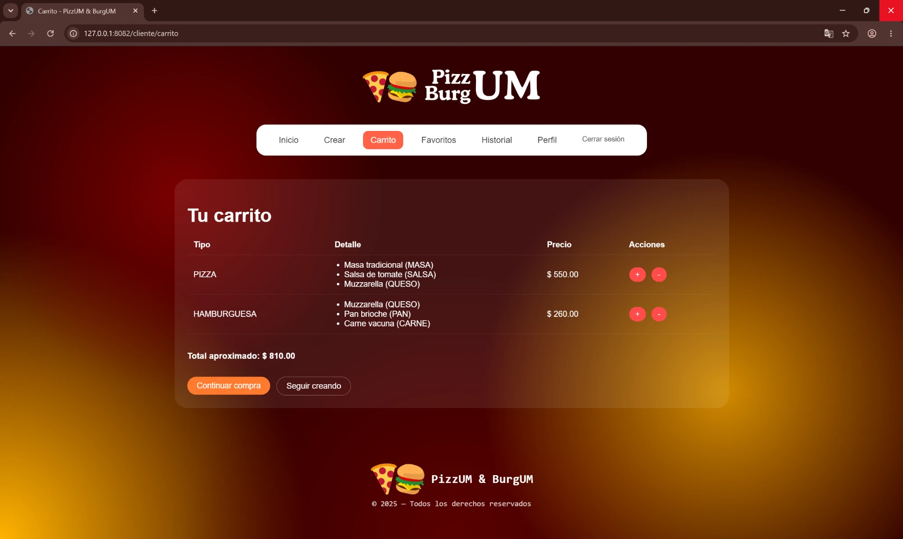
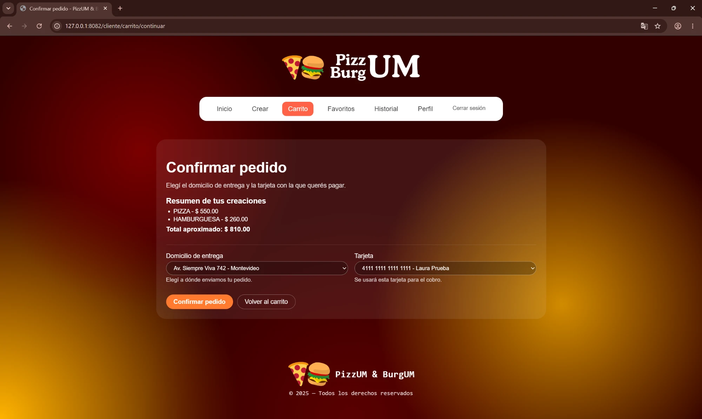
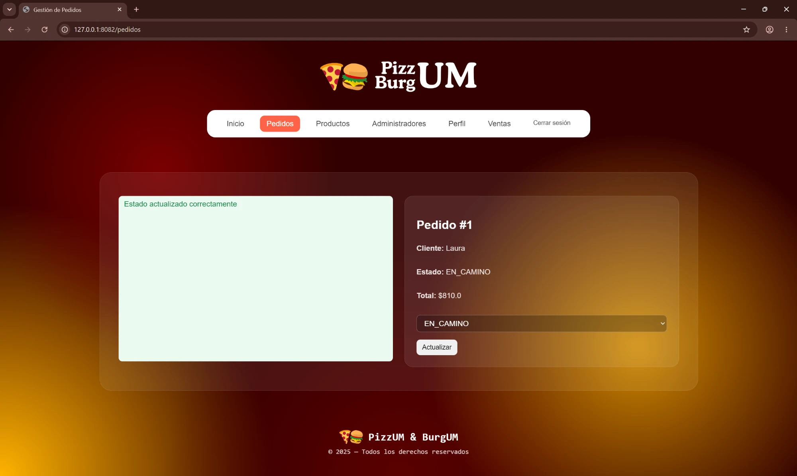

# Entregable 4: CI/CD con Jenkins

**Programación Avanzada · Curso 2026 · Universidad de Montevideo**

**Integrantes:** Valentina Penén y Ekaterina Chechina

**Repositorio:** [github.com/valentinapenen/Lab-04-CI-CD](https://github.com/valentinapenen/Lab-04-CI-CD)

## Arquitectura de la solución

La solución tiene dos partes: la aplicación web y la infraestructura de integración y despliegue continuo. Todo corre en una computadora local con Docker.

```text
  Desarrolladoras
        │ git push / merge de PR
        ▼
 ┌──────────────┐  Poll SCM cada 2 min    ┌────────────────────────────────┐
 │    GitHub    │◄────────────────────────│ Jenkins (contenedor)           │
 │  rama main   │       checkout          │ jenkins-lab04 · 127.0.0.1:8081 │
 └──────────────┘                         │                                │
                                          │ 1. Descargar código            │
                                          │ 2. Compilar, probar (H2) y     │
                                          │    empaquetar el JAR           │
                                          │ 3. Guardar JAR                 │
                                          │ 4. Desplegar en simulado       │
                                          └───────────────┬────────────────┘
                                                          │ publicar.sh copia el JAR
                                                          ▼
                                     ┌──────────────────────────────────────┐
                                     │ Volumen compartido jenkins_lab04_home│
                                     │  releases/  JAR por versión y        │
                                     │             current.jar              │
                                     │  status/    versión que respondió    │
                                     └───────────────────┬──────────────────┘
                                                         │ ejecutar.sh detecta el cambio
                                                         ▼
 ┌──────────────────────────────────────────────────────────────────────────┐
 │ Ambiente simulado de producción (compose.simulado.yml)                   │
 │   app: java -jar current.jar ─── 127.0.0.1:8082                          │
 │   postgres: PostgreSQL 15 con su propio volumen                          │
 └──────────────────────────────────────────────────────────────────────────┘
```

### Aplicación

PizzUM & BurgUM es una aplicación Spring Boot de pedidos para una pizzería y hamburguesería. Está organizada en capas: controladores MVC con vistas Thymeleaf, servicios con las reglas de negocio, repositorios Spring Data JPA y entidades. Spring Security separa los perfiles de cliente y administrador.

La aplicación integra varios módulos funcionales:

| Módulo | Qué hace | Clases principales |
| --- | --- | --- |
| Productos | El administrador carga ingredientes y define sus precios | `ProductoService`, `ProductoController` |
| Creaciones y carrito | El cliente arma pizzas y hamburguesas, las guarda como favoritas y las agrega al carrito | `CreacionService`, `ClienteController` |
| Pedidos | El cliente confirma el carrito con domicilio y tarjeta. El administrador avanza el estado del pedido | `PedidoService`, `PedidoController` |
| Usuarios | Registro, inicio de sesión, domicilios y tarjetas | `ClienteService`, `ConfiguracionSeguridad` |

El flujo que probamos con más detalle cruza tres módulos. Las creaciones usan los productos y su precio, y el pedido se arma a partir del carrito.

### Ambientes

| Ambiente | Dónde corre | Base de datos | Uso |
| --- | --- | --- | --- |
| Desarrollo | `mvnw spring-boot:run`, en `localhost:8080` | PostgreSQL de `docker-compose.yml` | Programar y probar localmente |
| Pruebas automáticas | Dentro de cada corrida de Jenkins | H2 en memoria, se crea y se borra en cada corrida | Ejecutar las pruebas sin depender de una base externa |
| Simulado de producción | Contenedor `app` de `compose.simulado.yml`, en `127.0.0.1:8082` | PostgreSQL propio, separado del de desarrollo | Recibir cada versión que aprueba el pipeline |

Jenkins y el ambiente simulado comparten un volumen de Docker. Jenkins deja ahí el JAR de cada versión y apunta `current.jar` a la nueva. El contenedor de la aplicación detecta el cambio, reinicia con ese JAR y registra qué versión devolvió HTTP 200. Jenkins da el despliegue por bueno cuando ese registro coincide con lo que publicó. Así, cada despliegue queda asociado a un número de corrida y a un commit (`app-<corrida>-<commit>.jar`).

## Decisiones tomadas y su justificación

| Decisión | Justificación |
| --- | --- |
| **Reutilizar PizzUM & BurgUM** | Es una aplicación que desarrollamos para Proyecto TIC (2025). Ya tenía varios módulos que se integran entre sí, así que pudimos dedicar el tiempo al proceso de CI/CD, que es el foco del entregable. Conservamos su historial de Git. |
| **Java 21 con Spring Boot 3.5** | La letra pide Java con Spring. La aplicación ya estaba hecha así, y Java 21 es la versión LTS que usan tanto la imagen de Jenkins como el ambiente simulado. |
| **Maven Wrapper** | Jenkins compila con `./mvnw` y no necesita tener Maven instalado. La versión de Maven queda fija en el repositorio. |
| **PostgreSQL para desarrollo y producción simulada** | Es la base que ya usaba la aplicación. El ambiente simulado tiene su propia instancia para no mezclar datos con desarrollo. |
| **H2 en memoria para las pruebas** | Las pruebas no dependen de que haya una base levantada, arrancan de cero en cada corrida y no ensucian otros ambientes. Las opciones se pasan por línea de comandos en el `Jenkinsfile`. |
| **JUnit 5 y Mockito para las pruebas unitarias, y `@SpringBootTest` para las de integración** | Las unitarias prueban la lógica de un servicio con repositorios simulados. Las de integración levantan Spring con los repositorios reales sobre H2. Para la vista usamos MockMvc con Spring Security Test. |
| **Jenkins en Docker** | Se instala con un solo comando, usa el mismo Java 21 y guarda su configuración en un volumen, así que sobrevive a reinicios. |
| **Pipeline declarativo versionado (`Jenkinsfile`)** | El pipeline queda en el repositorio junto al código. Los cambios al pipeline pasan por Git como cualquier otro cambio. |
| **Poll SCM cada 2 minutos en lugar de webhook** | Jenkins corre en una computadora local que GitHub no puede alcanzar desde internet, así que un webhook no llegaría sin exponer la máquina. Con el polling, Jenkins es el que consulta a GitHub. El costo es una demora de hasta 2 minutos. |
| **Docker Compose como ambiente simulado** | La letra permite una carpeta local o un contenedor. El contenedor aísla la aplicación y su base, se levanta con un comando y se parece más a un servidor real. |
| **Confirmar el despliegue con HTTP 200 y volver a la versión anterior** | Que el JAR se copie no garantiza que la aplicación arranque. El pipeline espera a que la versión nueva responda. Si no responde a tiempo, vuelve a activar la versión anterior y la corrida falla. |
| **Ramas por tarea y pull requests a `main`** | `main` es la rama que se despliega. Cada cambio entra por un PR, y el merge es lo que dispara el pipeline. |

## Etapas del pipeline

1. **Descargar código.** Jenkins carga el `Jenkinsfile` del repositorio y hace `checkout scm` con la rama y la credencial configuradas en el trabajo.
2. **Compilar, probar y empaquetar.** Maven Wrapper ejecuta `clean package` con H2 en memoria y desactiva la creación del administrador inicial para esa corrida. Si las pruebas pasan, Maven genera el JAR ejecutable.
3. **Guardar JAR.** Jenkins archiva el JAR y registra su huella digital para poder identificar el archivo que produjo cada corrida.
4. **Desplegar en simulado.** [`publicar.sh`](../deploy/simulado/publicar.sh) copia el JAR al volumen compartido y selecciona la nueva versión. [`ejecutar.sh`](../deploy/simulado/ejecutar.sh) detecta el cambio, reinicia la aplicación con ese JAR y registra qué versión devuelve HTTP 200 en la página de inicio. Jenkins confirma el despliegue cuando ese registro coincide con el JAR publicado. Si vence la espera y hay una versión anterior, el script vuelve a seleccionarla y la etapa termina con error.

## Instructivo de ejecución

Requisitos: Windows, macOS o Linux con **Docker Desktop** (o Docker Engine con Compose), **Git** y, para correr la aplicación fuera de Docker, **JDK 21**. Los comandos están escritos para PowerShell. En Linux o macOS, usar `./mvnw` en lugar de `.\mvnw.cmd`.

### 1. Obtener el código

```powershell
git clone https://github.com/valentinapenen/Lab-04-CI-CD.git
cd Lab-04-CI-CD
```

### 2. Ejecutar la aplicación en desarrollo (opcional)

```powershell
docker compose up -d postgres
.\mvnw.cmd spring-boot:run
```

La aplicación queda en `http://localhost:8080/`. El administrador inicial se crea con los datos `app.seed-admin.*` de `application.properties`.

### 3. Ejecutar las pruebas localmente

Con las mismas opciones de H2 que usa el pipeline:

```powershell
.\mvnw.cmd test '-Dspring.datasource.url=jdbc:h2:mem:pruebas;DB_CLOSE_DELAY=-1' '-Dspring.datasource.driver-class-name=org.h2.Driver' '-Dspring.datasource.username=sa' '-Dspring.datasource.password=' '-Dspring.jpa.properties.hibernate.dialect=org.hibernate.dialect.H2Dialect' '-Dspring.jpa.hibernate.ddl-auto=create-drop' '-Dspring.jpa.show-sql=false' '-Dapp.seed-admin=false'
```

El resultado esperado es `Tests run: 22, Failures: 0, Errors: 0`.

### 4. Levantar Jenkins

```powershell
docker run -d --name jenkins-lab04 -p 127.0.0.1:8081:8080 -v jenkins_lab04_home:/var/jenkins_home jenkins/jenkins:lts-jdk21
docker exec jenkins-lab04 cat /var/jenkins_home/secrets/initialAdminPassword
```

Abrir `http://127.0.0.1:8081/`, pegar la contraseña inicial, instalar los plugins sugeridos (incluyen Git y Pipeline) y crear el usuario administrador. Las próximas veces alcanza con `docker start jenkins-lab04`.

### 5. Levantar el ambiente simulado de producción

El ambiente usa un archivo `deploy/simulado/.env` con las contraseñas de su base y de su administrador. Git lo ignora. Este bloque lo genera la primera vez, prepara las carpetas en el volumen de Jenkins y levanta los contenedores:

```powershell
$simEnv = 'deploy/simulado/.env'
if (-not (Test-Path -LiteralPath $simEnv)) {
    $dbPassword = [Guid]::NewGuid().ToString('N')
    $adminPassword = [Guid]::NewGuid().ToString('N')
    @(
        "LAB04_SIM_DB_PASSWORD=$dbPassword"
        "LAB04_SIM_ADMIN_PASSWORD=$adminPassword"
    ) | Set-Content -LiteralPath $simEnv -Encoding ascii
}
docker exec jenkins-lab04 mkdir -p /var/jenkins_home/lab04-simulado/releases /var/jenkins_home/lab04-simulado/status
docker compose --env-file $simEnv -f compose.simulado.yml up -d
```

Hasta el primer despliegue, el contenedor `app` espera sin servir nada. Después de la primera corrida exitosa, la aplicación queda en `http://127.0.0.1:8082/`. Para iniciar sesión como administrador, se usa el correo `app.seed-admin.correo` y la contraseña `LAB04_SIM_ADMIN_PASSWORD` del `.env`.

### 6. Configurar los trabajos de Jenkins

1. En **Manage Jenkins → Credentials**, agregar una credencial *Username with password* con ID `github-lab04`: el usuario de GitHub y un token con permiso de lectura del repositorio. Hace falta porque el repositorio es privado.
2. Crear el trabajo **`lab04-pruebas`** de tipo *Pipeline*:
   - **Build Triggers:** *Poll SCM* con `H/2 * * * *`.
   - **Pipeline:** *Pipeline script from SCM*, Git, la URL del repositorio, la credencial `github-lab04`, la rama `*/main` y el script `Jenkinsfile`.
3. Crear el trabajo **`lab04-demo-fallo`** con la misma configuración, pero con la rama `*/demo/prueba-fallida` y sin *Poll SCM*. Se ejecuta a mano para mostrar el caso fallido.

### 7. Demostración

- **Caso exitoso:** subir un cambio a `main`, directo o con el merge de un PR. En hasta 2 minutos aparece una corrida nueva de `lab04-pruebas`. En **Console Output** se ven `Started by an SCM change`, el commit, el total de pruebas y `Despliegue confirmado: HTTP 200 para <commit>`. Al recargar `http://127.0.0.1:8082/` se ve la versión nueva.
- **Caso con fallo:** ejecutar **Build Now** en `lab04-demo-fallo`. La prueba `crearAceptaPreciosNoNegativos` falla y Jenkins marca **Guardar JAR** y **Desplegar en simulado** como omitidas. La corrida termina en `FAILURE` y el 8082 sigue sirviendo la versión anterior. Para corregirlo, se arregla el código en una rama, se suben los cambios y se vuelve a ejecutar.

Para detener todo sin perder datos:

```powershell
docker compose --env-file deploy/simulado/.env -f compose.simulado.yml stop
docker stop jenkins-lab04
```

## Resultados de las corridas

| Caso | Pruebas | Resultado del despliegue |
| --- | --- | --- |
| [Despliegue exitoso · `lab04-pruebas` #10](../jenkins-10-despliegue-exitoso.log) | 9 ejecutadas, 9 aprobadas | Jenkins publicó el JAR y confirmó HTTP 200 para ese commit. Terminó con `SUCCESS`. |
| [Pruebas de carrito y pedidos · `lab04-pruebas` #11](../jenkins-11-pruebas-unitarias.log) | 11 ejecutadas, 11 aprobadas | Se disparó automáticamente tras el merge del PR #1. Jenkins publicó el JAR de `bc58f29` y confirmó HTTP 200. Terminó con `SUCCESS`. |
| [Corrección del selector de estado · `lab04-pruebas` #12](../jenkins-12-correccion-selector.log) | 12 ejecutadas, 12 aprobadas | Se disparó automáticamente tras el merge del PR #2. Jenkins publicó el JAR de `3239e24` y confirmó HTTP 200. Terminó con `SUCCESS`. |
| [Regresión de precio cero · `lab04-demo-fallo` #1](../jenkins-demo-fallo-01.log) | 9 ejecutadas, 8 aprobadas y 1 con error | Jenkins omitió **Guardar JAR** y **Desplegar en simulado**. Terminó con `FAILURE`. |

La corrida #10 se inició automáticamente después del push a `main`. El log muestra `Started by an SCM change`, el commit que descargó Jenkins y `Despliegue confirmado: HTTP 200` para ese mismo commit.

Para el caso fallido, recuperamos en una rama de demostración el error que impedía crear productos con precio cero. Cambiamos la validación de `< 0` a `<= 0`. La prueba existente `crearAceptaPreciosNoNegativos` detectó la regresión cuando intentó crear un producto con precio cero. Después de la corrida, comprobamos que el ambiente seguía sirviendo `app-10-abce211ec063b9cdec925f26c5a5fb6b4a056363.jar` y respondía HTTP 200.

## Validación funcional del carrito y los pedidos

Elegimos el flujo de compra porque recorre los dos módulos principales: las creaciones del carrito y los pedidos. El punto de entrada es `CreacionService.crearPedidoDesdeCarrito()`. Ese método toma las creaciones que el cliente tiene en el carrito, calcula el total, guarda el pedido en `EN_COLA` y saca las creaciones del carrito sin borrar los favoritos.

### Pruebas por módulo

La suite tiene **22 pruebas**. Cada módulo tiene pruebas unitarias de su servicio, con los repositorios simulados con Mockito, y el flujo de compra tiene además pruebas que levantan Spring:

| Módulo | Clase de prueba | Tipo | Casos | Qué comprueba |
| --- | --- | --- | --- | --- |
| Productos | `ProductoServiceTests` | Unitaria | 8 | Al crear un producto o cambiar su precio, acepta cero y valores positivos y rechaza los negativos sin guardar. |
| Creaciones y carrito | `CreacionServiceTests` | Unitaria | 1 | No se puede confirmar un carrito vacío. |
| Pedidos | `PedidoServiceTests` | Unitaria | 6 | El administrador avanza el estado y puede cancelar un pedido en cola. No se puede retroceder el estado ni modificar un pedido cancelado. El cliente no puede cancelar un pedido en preparación ni el pedido de otro cliente. |
| Usuarios | `ClienteServiceTests` | Unitaria | 4 | El registro cifra la contraseña y guarda el domicilio y la tarjeta como predeterminados, con el vencimiento al último día del mes. Rechaza contraseñas distintas, un correo o una cédula ya registrados, sin guardar nada. |
| Carrito y pedidos | `CreacionPedidoIntegrationTests` | Integración (Spring + H2) | 1 | Confirmar el carrito guarda el pedido con el total correcto, en `EN_COLA`, y vacía el carrito. |
| Pedidos (vista) | `PedidoControllerTests` | Integración (MockMvc) | 1 | El selector de estado del administrador muestra el estado actual. |
| Aplicación | `PizzUmBurgUmApplicationTests` | Contexto | 1 | El contexto de Spring carga. |

Las pruebas de `PedidoServiceTests` cubren las reglas de estado que aparecieron en la prueba manual, y las de `ClienteServiceTests` usan los mismos datos ficticios de la clienta de esa prueba. Las agregamos al final, cuando revisamos que la letra pide pruebas unitarias de cada módulo.

### Pruebas del flujo de compra

Las pruebas se desarrollaron en la rama `test/carrito-pedidos` y se incorporaron a `main` mediante el pull request #1.

| Prueba | Tipo | Qué comprueba |
| --- | --- | --- |
| `CreacionServiceTests.crearPedidoDesdeCarrito_carritoVacio_rechazaYSinGuardarPedido` | Unitaria, con repositorios simulados (Mockito) | Con el carrito vacío, el servicio lanza `IllegalStateException("El carrito está vacío")` y no llama a `pedidoRepository.save`. |
| `CreacionPedidoIntegrationTests.crearPedidoDesdeCarrito_conDatosFicticios_guardaPedidoEnColaYLimpiaCarrito` | Integración, con Spring Boot y H2 en memoria | Con un cliente, un domicilio, una tarjeta y dos creaciones ficticias de $350 y $150, el pedido se guarda con un total de $500 y en `EN_COLA`. La prueba también lo lee desde la base y comprueba que el carrito quedó vacío. |

La prueba de integración usa los repositorios reales sobre H2 y corre dentro de una transacción que se revierte al terminar. Fija el precio de cada creación, así que verifica la suma del total pero no el cálculo del precio de cada pizza o hamburguesa.

Antes del merge ejecutamos la suite localmente con las opciones de H2 del README: **11 pruebas, 0 fallos y 0 errores**. Eso incluye las 9 que ya existían y las 2 nuevas.

Después del merge, Jenkins detectó el cambio en `main` mediante Poll SCM e inició la [corrida #11 de `lab04-pruebas`](../jenkins-11-pruebas-unitarias.log) con `Started by an SCM change`. Descargó el commit `bc58f29` y ejecutó las 11 pruebas sin fallos ni errores. Después publicó `app-11-bc58f29c295e8d4d66143ae021bd6411ecec0453.jar` y confirmó HTTP 200 para ese commit. El ambiente simulado pasó de la versión del build #10 a la del #11.

### Prueba manual desde la web

Hicimos la prueba en el ambiente simulado (`http://127.0.0.1:8082/`), con la versión del build #12 y una base vacía. Usamos datos ficticios con precios elegidos para que el total se pueda verificar a mano:

| Producto | Tipo | Precio |
| --- | --- | --- |
| Masa tradicional | MASA | $50 |
| Salsa de tomate | SALSA | $30 |
| Muzzarella | QUESO | $70 |
| Pan brioche | PAN | $40 |
| Carne vacuna | CARNE | $150 |

El administrador cargó estos productos. Después registramos una clienta ficticia, Laura Prueba, con un domicilio y la tarjeta de prueba `4111 1111 1111 1111`.

**1. Carrito.** La clienta armó una pizza mediana: $400 de precio base del tamaño, más masa, salsa y muzzarella, en total $550. También armó una hamburguesa con pan, carne y muzzarella, por $260. El carrito muestra las dos creaciones y un total de $810.



**2. Confirmación.** Antes de confirmar, la aplicación muestra el resumen y pide elegir el domicilio de entrega y la tarjeta.



**3. Seguimiento.** Al confirmar, el pedido 1 queda en `EN_COLA` y el carrito queda vacío.


**4. Cambio de estado como administrador.** En **Pedidos**, el administrador avanzó el pedido. El selector muestra el estado actual del pedido. Ese comportamiento es la corrección del error que describimos en [Problemas encontrados](#problemas-encontrados-y-cómo-los-resolvimos).



**5. Vista de la clienta.** Después de que el administrador marcó el pedido como entregado, la clienta lo ve en su historial como `ENTREGADO`. El detalle muestra la fecha, el total de $810, el pago con tarjeta, el domicilio y los productos de cada creación con su precio.


| Caso | Resultado esperado | Resultado obtenido |
| --- | --- | --- |
| Calcular el precio de cada creación | Pizza: tamaño + ingredientes. Hamburguesa: suma de ingredientes | ✅ Pizza $550 y hamburguesa $260 |
| Confirmar un pedido desde el carrito | Se crea un pedido en `EN_COLA` con el total del carrito | ✅ Pedido 1 en `EN_COLA` por $810 |
| Cambiar el estado como administrador | El selector parte del estado actual y el cambio se guarda | ✅ "Estado actualizado correctamente", pedido en `EN_CAMINO` |
| Ver el estado desde la cuenta del cliente | El cliente ve el estado y el detalle actualizados | ✅ Historial con el pedido en `ENTREGADO` |

## Problemas encontrados y cómo los resolvimos

- **Jenkins no podía clonar el repositorio privado.** Las corridas #1 y #2 terminaron con `Authentication failed`. Guardamos una credencial de lectura en Jenkins y la asociamos al acceso al repositorio.
- **La aplicación rechazaba el precio cero.** Ajustamos la validación del servicio de productos y agregamos casos de prueba para cero, precios positivos y negativos. Recuperamos el rechazo únicamente en la rama de demostración para comprobar que el pipeline detecta el error antes de desplegar.
- **El administrador cancelaba pedidos sin querer.** Lo encontramos en la prueba manual sobre el ambiente simulado. Intentamos pasar un pedido de `EN_COLA` a `EN_PREPARACION`, pero quedó `CANCELADO`. El selector de estado de la lista de pedidos no marcaba el estado actual y mostraba `CANCELADO`, la primera opción. Además, la página se recarga cada 5 segundos, así que la opción elegida se perdía y **Actualizar** enviaba `CANCELADO`. Como el servicio permite cancelar un pedido en `EN_COLA` y no deja modificar un pedido cancelado, el pedido quedó cerrado.

  

  Las pruebas automáticas no lo detectaban porque cubrían los servicios, pero no la vista. Agregamos `PedidoControllerTests`: la prueba abre `/pedidos` como administrador y comprueba que el selector muestra el estado actual y no propone `CANCELADO`. Primero confirmamos que fallaba con el código anterior. Después corregimos el template con `th:selected` para preseleccionar el estado actual. El cambio entró a `main` con el PR #2, y la [corrida #12](../jenkins-12-correccion-selector.log) lo probó y desplegó automáticamente con 12 pruebas aprobadas. Para repetir la prueba manual desde cero, vaciamos la base del ambiente simulado.

## Conclusiones

Con el pipeline pudimos pasar de un push a una versión disponible en el ambiente simulado. La corrida exitosa nos permite relacionar el commit, el JAR archivado y la versión que respondió. La corrida fallida mostró que una regresión detectada en las pruebas detiene la publicación y permite seguir usando la versión que ya estaba en ejecución.

La verificación automática del despliegue solo comprueba que responde la página de inicio. El flujo de compra lo cubrimos con pruebas unitarias y de integración y con una prueba manual desde la web. La prueba manual encontró un error en la pantalla del administrador que las pruebas automáticas no veían. Lo corregimos con el mismo circuito: rama, prueba que lo reproduce, pull request, y prueba y despliegue automáticos. Esos resultados están en [Validación funcional del carrito y los pedidos](#validación-funcional-del-carrito-y-los-pedidos).

### Dificultades

- **Conectar Jenkins con el repositorio.** Como el repositorio es privado, las primeras corridas fallaron por autenticación. Además, Jenkins corre en una computadora local que GitHub no puede alcanzar, así que no pudimos usar un webhook. Tuvimos que crear una credencial de lectura y configurar el polling.
- **Pasar el JAR de Jenkins al ambiente simulado.** Copiar el archivo no alcanzaba para saber si la versión nueva estaba funcionando. Diseñamos el intercambio por el volumen compartido, con un registro de la versión que respondió HTTP 200 y la vuelta a la versión anterior si la nueva no responde.
- **Separar la configuración por ambiente.** La aplicación heredada tenía la conexión a PostgreSQL fija en `application.properties`. Para las pruebas la reemplazamos por H2 desde la línea de comandos. Para el ambiente simulado usamos variables de entorno y un `.env` que no se sube al repositorio.
- **Trabajo en equipo con distintas configuraciones.** Una integrante no pudo usar Jenkins en su máquina. Pudo escribir las pruebas igual, porque se ejecutan localmente con H2, y la otra integrante las integró y verificó en el pipeline. Coordinar el trabajo con ramas y pull requests nos permitió avanzar en paralelo sin pisarnos.
- **Datos de prueba en el ambiente simulado.** Al recorrer el flujo de compra cargamos datos con errores, como un producto con la categoría equivocada, y el error del selector canceló un pedido que ya no se podía modificar. Para repetir la prueba desde cero tuvimos que vaciar la base del ambiente simulado.

### Qué aprendimos

Las pruebas automáticas dan confianza para desplegar solo si cubren lo que importa. Nuestras pruebas de servicios pasaban, y aun así la pantalla del administrador tenía un error que cancelaba pedidos. La prueba manual en un ambiente parecido a producción lo encontró, y el pipeline permitió corregirlo con el mismo proceso: una prueba que reproduce el error, el cambio, la revisión en un PR y el despliegue automático.
