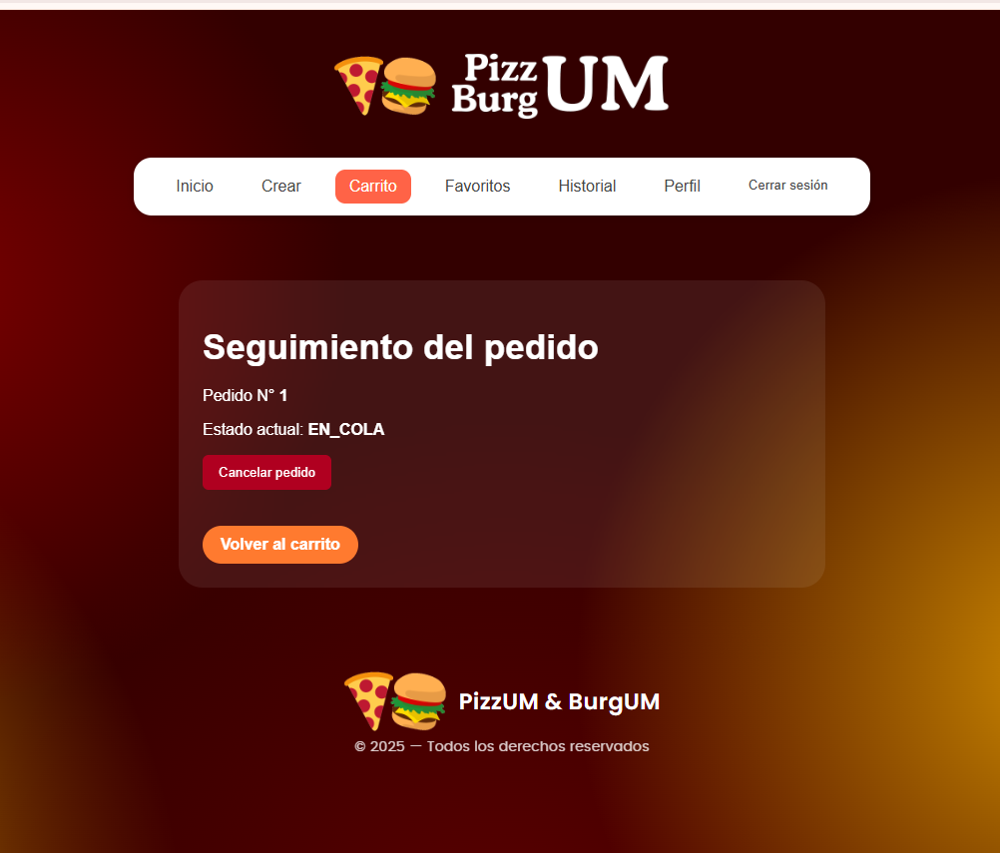
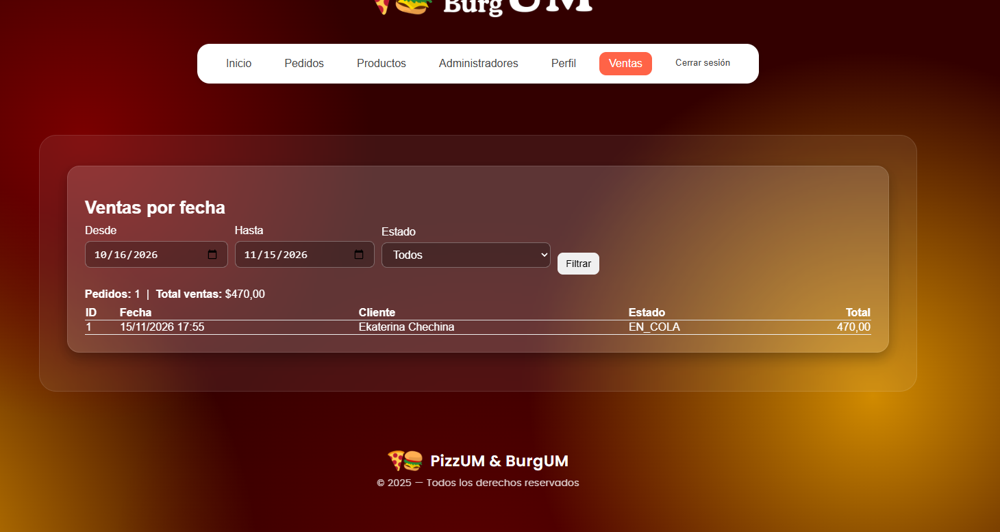
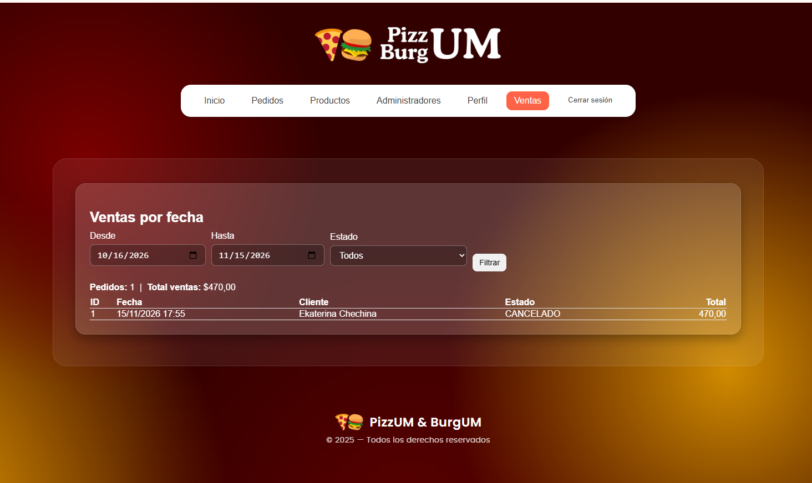

# Entregable 4: CI/CD

# Pipeline y despliegue simulado

## Arquitectura y decisiones

Reutilizamos PizzUM-BurgUM como base para el Entregable 4. Configuramos Jenkins para que tome el código de GitHub, ejecute las pruebas, genere el JAR y despliegue esa versión en un ambiente simulado. El flujo queda definido en el [Jenkinsfile](../Jenkinsfile).

Jenkins corre en Docker con Java 21. El ambiente simulado tiene su propio contenedor de aplicación y una base PostgreSQL separada del ambiente de desarrollo. Jenkins está disponible en el puerto `8081` y la aplicación simulada en el `8082`. Usamos un volumen compartido para pasar el JAR desde Jenkins al contenedor de la aplicación y registrar qué versión respondió. La configuración del ambiente está en [compose.simulado.yml](../compose.simulado.yml).

Configuramos **Poll SCM** en Jenkins con `H/2 * * * *`. Jenkins consulta GitHub cada dos minutos y, si encuentra un cambio en `main`, inicia el pipeline. Elegimos esta opción porque Jenkins corre en una computadora local y puede consultar GitHub directamente.

## Etapas del pipeline

1. **Descargar código.** Jenkins carga el `Jenkinsfile` del repositorio y hace `checkout scm` con la rama y la credencial configuradas en el trabajo.
2. **Compilar, probar y empaquetar.** Maven Wrapper ejecuta `clean package` con H2 en memoria y desactiva la creación del administrador inicial para esa corrida. Si las pruebas pasan, Maven genera el JAR ejecutable.
3. **Guardar JAR.** Jenkins archiva el JAR y registra su huella digital para poder identificar el archivo que produjo cada corrida.
4. **Desplegar en simulado.** [`publicar.sh`](../deploy/simulado/publicar.sh) copia el JAR al volumen compartido y selecciona la nueva versión. [`ejecutar.sh`](../deploy/simulado/ejecutar.sh) detecta el cambio, reinicia la aplicación con ese JAR y registra qué versión devuelve HTTP 200 en la página de inicio. Jenkins confirma el despliegue cuando ese registro coincide con el JAR publicado. Si vence la espera y hay una versión anterior, el script vuelve a seleccionarla y la etapa termina con error.

## Cómo repetir la demostración

1. Iniciar Docker Desktop y el contenedor `jenkins-lab04`. Levantar la aplicación y la base con los comandos de [Despliegue simulado](../README.md#despliegue-simulado).
2. En Jenkins, verificar que `lab04-pruebas` use **Pipeline script from SCM**, la rama `*/main`, el archivo `Jenkinsfile` y una credencial con acceso de lectura al repositorio. Guardar **Poll SCM** con `H/2 * * * *`.
3. Subir un cambio válido a `main` y esperar la consulta de Jenkins. En la consola, comprobar el disparo automático, el resultado de las pruebas y el hash del despliegue. Abrir la [aplicación simulada](http://127.0.0.1:8082/).
4. Para el caso fallido, ejecutar manualmente `lab04-demo-fallo`, que usa `*/demo/prueba-fallida`. Comprobar que falla el caso del precio cero, que Jenkins omite las etapas de guardado y despliegue y que la aplicación sigue respondiendo con la versión del caso exitoso.

## Resultados de las corridas

| Caso | Pruebas | Resultado del despliegue |
| --- | --- | --- |
| [Despliegue exitoso · `lab04-pruebas` #10](../jenkins-10-despliegue-exitoso.log) | 9 ejecutadas, 9 aprobadas | Jenkins publicó el JAR y confirmó HTTP 200 para ese commit. Terminó con `SUCCESS`. |
| [Regresión de precio cero · `lab04-demo-fallo` #1](../jenkins-demo-fallo-01.log) | 9 ejecutadas, 8 aprobadas y 1 con error | Jenkins omitió **Guardar JAR** y **Desplegar en simulado**. Terminó con `FAILURE`. |

La corrida #10 se inició automáticamente después del push a `main`. El log muestra `Started by an SCM change`, el commit que descargó Jenkins y `Despliegue confirmado: HTTP 200` para ese mismo commit.

Para el caso fallido, recuperamos en una rama de demostración el error que impedía crear productos con precio cero. Cambiamos la validación de `< 0` a `<= 0`. La prueba existente `crearAceptaPreciosNoNegativos` detectó la regresión cuando intentó crear un producto con precio cero. Después de la corrida, comprobamos que el ambiente seguía sirviendo `app-10-abce211ec063b9cdec925f26c5a5fb6b4a056363.jar` y respondía HTTP 200.

## Validación funcional del carrito y los pedidos

Elegimos el flujo de compra porque recorre los dos módulos principales: las creaciones del carrito y los pedidos. El punto de entrada es `CreacionService.crearPedidoDesdeCarrito()`. Ese método toma las creaciones que el cliente tiene en el carrito, calcula el total, guarda el pedido en `EN_COLA` y saca las creaciones del carrito sin borrar los favoritos.

### Pruebas automáticas

Las pruebas están en la rama `test/carrito-pedidos`.

| Prueba | Tipo | Qué comprueba |
| --- | --- | --- |
| `CreacionServiceTests.crearPedidoDesdeCarrito_carritoVacio_rechazaYSinGuardarPedido` | Unitaria, con repositorios simulados (Mockito) | Con el carrito vacío, el servicio lanza `IllegalStateException("El carrito está vacío")` y no llama a `pedidoRepository.save`. |
| `CreacionPedidoIntegrationTests.crearPedidoDesdeCarrito_conDatosFicticios_guardaPedidoEnColaYLimpiaCarrito` | Integración, con Spring Boot y H2 en memoria | Con un cliente, un domicilio, una tarjeta y dos creaciones ficticias de $350 y $150, el pedido se guarda con un total de $500 y en `EN_COLA`. La prueba también lo lee desde la base y comprueba que el carrito quedó vacío. |

La prueba de integración usa los repositorios reales sobre H2 y corre dentro de una transacción que se revierte al terminar. Fija el precio de cada creación, así que verifica la suma del total pero no el cálculo del precio de cada pizza o hamburguesa.

Ejecutamos la suite de la rama con las opciones de H2 del README: **11 pruebas, 0 fallos y 0 errores**. Eso incluye las 9 que ya existían y las 2 nuevas.

> **Pendiente:** agregar la corrida de Jenkins posterior al merge a `main`, con el número de build, el total de pruebas y la confirmación del despliegue.

### Prueba manual desde la web

Recorrimos el flujo con una cuenta de cliente y otra de administrador:

1. El cliente armó sus creaciones, las agregó al carrito y confirmó el pedido con un domicilio y una tarjeta de prueba.
2. El pedido quedó con el número 1 y el estado `EN_COLA` en el seguimiento del cliente.
3. En **Ventas por fecha**, el administrador vio el pedido del 15/11/2026 a las 17:55, por $470,00 y en `EN_COLA`.
4. El pedido pasó a `CANCELADO`, y el listado de ventas del administrador mostró el nuevo estado.

> **Pendiente:** confirmar en qué ambiente se tomaron las capturas, porque no muestran la URL, y quién canceló el pedido, si el cliente o el administrador. Agregar capturas en `http://127.0.0.1:8082/` con la URL visible: el carrito con las creaciones y sus precios, la confirmación con domicilio y tarjeta, el cambio de estado desde **Pedidos** como administrador (por ejemplo, de `EN_COLA` a `EN_PREPARACION`) y el seguimiento del cliente con el estado nuevo.

| Caso | Resultado esperado | Resultado obtenido |
| --- | --- | --- |
| Confirmar un pedido desde el carrito | Se crea un pedido en `EN_COLA` con el total del carrito | ✅ Pedido 1 en `EN_COLA` por $470,00 |
| Ver el pedido como administrador | Aparece en ventas con su cliente, su estado y su total | ✅ Aparece en **Ventas por fecha** |
| Cambiar el estado del pedido | El nuevo estado se ve para el administrador y el cliente | ⚠️ Se ve `CANCELADO` en ventas. Falta el avance de estado como administrador y la vista del cliente |

## Problemas encontrados y cómo los resolvimos

- **Jenkins no podía clonar el repositorio privado.** Las corridas #1 y #2 terminaron con `Authentication failed`. Guardamos una credencial de lectura en Jenkins y la asociamos al acceso al repositorio.
- **La aplicación rechazaba el precio cero.** Ajustamos la validación del servicio de productos y agregamos casos de prueba para cero, precios positivos y negativos. Recuperamos el rechazo únicamente en la rama de demostración para comprobar que el pipeline detecta el error antes de desplegar.

## Conclusiones

Con el pipeline pudimos pasar de un push a una versión disponible en el ambiente simulado. La corrida exitosa nos permite relacionar el commit, el JAR archivado y la versión que respondió. La corrida fallida mostró que una regresión detectada en las pruebas detiene la publicación y permite seguir usando la versión que ya estaba en ejecución.

La verificación automática del despliegue solo comprueba que responde la página de inicio. El flujo de compra lo cubrimos con pruebas unitarias y de integración y con una prueba manual desde la web. Esos resultados están en [Validación funcional del carrito y los pedidos](#validación-funcional-del-carrito-y-los-pedidos).
